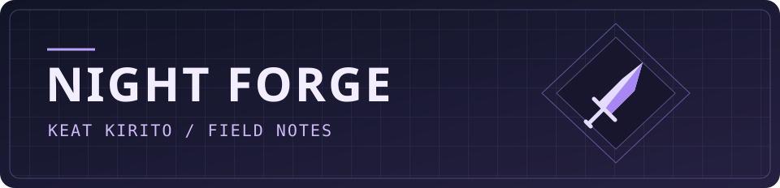

# keat kirito / 夜间工坊

想给智能体多一点探索陌生环境的余地，也想给科研推导多一条可以回头核对的路径。

| 工作台 | 在探索什么 |
| --- | --- |
| 智能体系统 | 智能体如何理解开放环境，在条件变化时调整行动。 |
| 物理形式化 | 怎样用 Lean 4 表达物理假设，并检查推导过程。 |
| AI 科研基础设施 | 怎样把问题、证据和复核记录接进日常工作流。 |

**工具箱**：TypeScript / Next.js · Python · Lean 4

展开贡献轨迹

<picture>
  <source media="(prefers-color-scheme: dark)" srcset="https://raw.githubusercontent.com/Keatlxw/Keatlxw/output/github-contribution-grid-snake-dark.svg" />
  
</picture>

[查看 GitHub 原生贡献日历](https://github.com/Keatlxw#contribution-graph)

[浏览公开仓库](https://github.com/Keatlxw?tab=repositories)
