### Keat Kirito

研究 agent takein：agent 进入陌生环境后，怎样建立对环境的模型、用好手边的工具，并把每次纠错变成自己的能力。

**最近在做**

- **PhysForm**：agent takein 在科研上的实践。把统计物理论文里的结论写成 Lean 4 定理，由 AI 证明，再交给独立的检查程序复核。
- **RelFuc_WM**：物理一致的世界模型。解析物理内核加上学习的接触残差，用硬约束保证不穿透和能量守恒。
- **AxisAgentic**：长程 agent 的运行时与轨迹采集框架。
- **AI 招生 CRM**：agent takein 的工程落地，把 agent 接进招生业务的真实流程。私有仓库。

<picture>
  <source media="(prefers-color-scheme: dark)" srcset="https://raw.githubusercontent.com/Keatlxw/Keatlxw/output/github-contribution-grid-snake-dark.svg" />
  
</picture>
