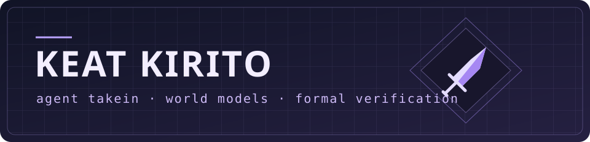

### Keat Kirito

研究 AI agent 和形式化验证，也写全栈应用。

**最近在做**

- **PhysForm**：把统计物理论文里的结论写成 Lean 4 定理，由 AI 证明，再交给独立的检查程序复核。
- **agent takein**：研究 agent 进入陌生环境后，怎样摸清规则、用好工具、不再重复犯错。
- **AI 招生 CRM**：Next.js + TypeScript 全栈项目，私有仓库。

**常用工具**：TypeScript · Next.js · Python · Lean 4

<picture>
  <source media="(prefers-color-scheme: dark)" srcset="https://raw.githubusercontent.com/Keatlxw/Keatlxw/output/github-contribution-grid-snake-dark.svg" />
  
</picture>
